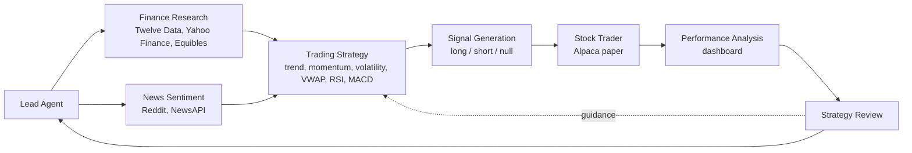

# Build a Multi AI Agents Workflow for Stock Trading

Build, from scratch, a multi AI agents workflow for stock trading with AI vibe coding: eight cooperating agents that research a stock, read Reddit and news sentiment, formulate a strategy, generate long or short signals, trade on an Alpaca paper account, measure their own performance and improve their strategy.

| Course detail | Information |
|---|---|
| Course code | `C177` |
| Programme | Non-WSQ |
| Duration | 1 day, 7.5 hours (9:30am - 5:30pm) |
| Prerequisite | [AI Powered Quantitative Trading Fundamentals (C728)](https://www.tertiarycourses.com.sg/ai-powered-quantitative-trading-fundamentals.html) - C728 demonstrates the multi AI agents trading system; C177 teaches you to build it |
| Registration | [View course details and register](https://www.tertiarycourses.com.sg/build-a-multi-ai-agents-workflow-for-stock-trading.html) |

## About the course

You design eight agents and direct an AI coding assistant (Claude Code, OpenAI Codex or GitHub Copilot) to write each one, then review the code against a written message contract and prove it with tests. A **lead agent** orchestrates the flow: the **finance research agent** gathers Twelve Data candles at 1-minute, 15-minute and 1-hour intervals plus Yahoo Finance and Equibles company data; the **news sentiment agent** reads Reddit through the Reddit API and headlines from NewsAPI; the **trading strategy agent** merges both into a strategy built on trend, momentum, volatility, VWAP, RSI, MACD or a mix; the **signal generation agent** issues long, short or null; the **stock trader agent** places the order on an Alpaca paper account; the **performance analysis agent** reports return, Sharpe, drawdown and win rate on a dashboard; and the **strategy review agent** updates the strategy for the next run. You finish by publishing your project to GitHub.



## Learning outcomes

- **LO1** - Design a multi AI agents trading workflow: the eight agent roles, the message contract between them and a lead agent that orchestrates the flow.
- **LO2** - Vibe-code the research agents that gather Twelve Data candles, Yahoo Finance and Equibles company data, and Reddit and NewsAPI sentiment.
- **LO3** - Vibe-code the decision and execution agents that formulate a strategy from trend, momentum, volatility, VWAP, RSI and MACD, generate long, short or null signals and place orders on an Alpaca paper account.
- **LO4** - Close the loop with a performance dashboard and a strategy review agent, orchestrate the full workflow and publish the project to GitHub.

## Topics covered

1. **Designing a Multi AI Agents Trading Workflow** - agent roles, the message contract, lead orchestration and the AI vibe coding loop (Lab 1).
2. **Building the Research and Decision Agents** - multi-timeframe candles, company and alternative data, Reddit and news sentiment, algorithm mixes and signals (Labs 2-5).
3. **Execution, Performance and the Feedback Loop** - Alpaca paper execution, performance metrics and dashboard, strategy review, orchestration and GitHub (Labs 6-8).

## Labs

Each lab: read the key concepts, paste the prompts into your AI coding assistant, review the code, run the lab's check, commit.

| Lab | Title | Time | Check |
|---|---|---|---|
| 1 | [Scaffold the Project and the Agent Message Contract](labs/lab-01-scaffold-the-project-and-the-agent-contract/README.md) | 35 min | `tests/test_lab1.py` |
| 2 | [Build the Finance Research Agent](labs/lab-02-finance-research-agent/README.md) | 35 min | `tests/test_lab2.py` |
| 3 | [Build the News Sentiment Agent with Reddit and NewsAPI](labs/lab-03-news-sentiment-agent-with-reddit/README.md) | 35 min | `tests/test_lab3.py` |
| 4 | [Build the Trading Strategy Agent](labs/lab-04-trading-strategy-agent/README.md) | 35 min | `tests/test_lab4.py` |
| 5 | [Build the Signal Generation Agent](labs/lab-05-signal-generation-agent/README.md) | 20 min | `tests/test_lab5.py` |
| 6 | [Build the Stock Trader Agent on Alpaca Paper](labs/lab-06-stock-trader-agent-on-alpaca/README.md) | 30 min | `tests/test_lab6.py` |
| 7 | [Build the Performance Analysis Agent and the Dashboard](labs/lab-07-performance-analysis-agent-and-dashboard/README.md) | 30 min | `tests/test_lab7.py` |
| 8 | [Close the Loop: Strategy Review, Lead Agent and GitHub](labs/lab-08-strategy-review-lead-agent-and-github/README.md) | 65 min | `tests/test_lab8.py` |

The complete reference project - all eight agents, the dashboard, offline sample data and the acceptance checks - is in [`labs/solution/`](labs/solution/). It runs without any API keys:

```bash
cd labs/solution
python -m venv .venv && source .venv/bin/activate
pip install -e ".[dev]"
OFFLINE=true python run.py NVDA AAPL SPY
pytest -q
```

## Public package

| Item | Files |
|---|---|
| Trainer slides | [PPTX](courseware/Build%20a%20Multi%20AI%20Agents%20Workflow%20for%20Stock%20Trading%20%28C177%29-v2.0.pptx) · [PDF](courseware/Build%20a%20Multi%20AI%20Agents%20Workflow%20for%20Stock%20Trading%20%28C177%29-v2.0.pdf) |
| Lesson Plan | [DOCX](courseware/LP-Build%20a%20Multi%20AI%20Agents%20Workflow%20for%20Stock%20Trading%20%28C177%29.docx) · [PDF](courseware/LP-Build%20a%20Multi%20AI%20Agents%20Workflow%20for%20Stock%20Trading%20%28C177%29.pdf) |
| Learner Guide | [DOCX](courseware/LG-Build%20a%20Multi%20AI%20Agents%20Workflow%20for%20Stock%20Trading%20%28C177%29.docx) · [PDF](courseware/LG-Build%20a%20Multi%20AI%20Agents%20Workflow%20for%20Stock%20Trading%20%28C177%29.pdf) · [Markdown](LG-Build%20a%20Multi%20AI%20Agents%20Workflow%20for%20Stock%20Trading%20%28C177%29.md) |
| Labs | [`labs/`](labs/) - eight lab guides and the reference solution |

Courseware version 2.0 (25 October 2026), generated from the single source in `.agents/skills/non-wsq-courseware-build/`.

## Distribution

This repository publishes the learner and trainer courseware and the reference solution. API keys are never committed - copy `.env.example` to `.env` locally. The sample data is synthetic and for training only. All trading is paper trading and nothing here is investment advice.

---

Developed and delivered by [Tertiary Infotech Academy Pte Ltd](https://www.tertiarycourses.com.sg/) (UEN 201200696W).
